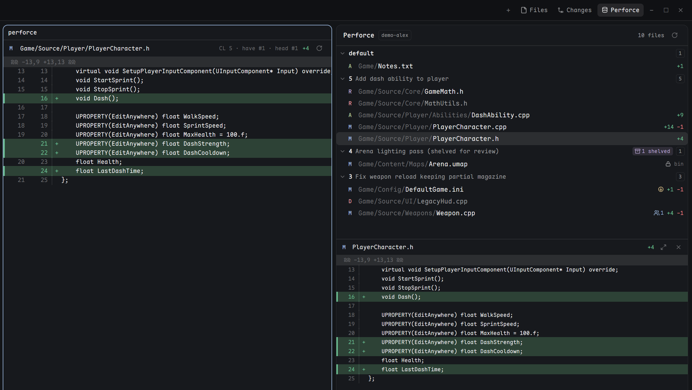

# Perforce

A read-only Perforce panel for the Herdr app's right-hand sidebar, next to Files and Changes. It shows the pending changelists of the shown space's Perforce client the way P4V's Pending tab does: one group per changelist (default first), the files open in each, their status, line counts, and a diff against the have revision. A wide diff can be opened as a pane beside the terminals and follows the panel's selection.



## What you see

- **Tab bar button** `Perforce` (database icon, `mods/perforce/perforce.svg`) after Files and Changes. It opens the panel in the same right-hand stack (`panel-body`), remembered per space like the other two.
- **Header** (42 px): `Perforce`, a chip with the client name (hover: client, root, stream), the open file count, and a refresh button that turns into a spinner during a manual refresh. If the last refresh failed, a red bar `Stale · <reason>` sits under it while the previous list stays.
- **Changelist list**, a virtual list:
  - Change rows (30 px): chevron, change number (or `default`), first description line, a purple `N shelved` chip when the change has shelved files, and a file count. Hover shows the full description.
  - File rows (26 px), indented: an action letter, the path relative to the client root (folder dimmed and cut from the left, file name bright), status icons, and `+added −deleted` (a zero side hidden, `bin` for binary files).
  - Action letters: `M` edit (ansi4), `A` add (ansi2), `D` delete (ansi1), `R` move/add (ansi5) and move/delete (ansi1), `B` branch, `I` integrate, `A` import, `X` purge/archive.
  - Status icons, each with a tooltip: out of date (have < head, ansi3), needs resolve (ansi1), locked (by you or exclusive `+l`: muted; by someone else: ansi1), and a people icon with a count when other users have it open (ansi4).
  - Hovering a file shows the depot path, action, type, have/head revisions, the move source or target, and every status in words.
- **Diff** under the list (takes the rest of the height; the list takes up to 45%): a 32 px bar with the action letter, file name, counts, an expand button and a close button, then a unified diff in the terminal font at 11 px with a 3 px colored edge, colored line numbers and a gutter rule. Dark: added `#2d4236` with `#68b78d`, deleted `#51292b` with `#ea7f81`; light: `#e6ffec`/`#1a7f37`, `#ffebe9`/`#cf222e`. Hunk headers on `raised`.
- **Wide diff pane** (the same mod with `props: { view: "diff", space }`): a 34 px bar with the path, `CL n · have #x · head #y`, counts and refresh, then the diff with old and new line numbers at 12 px.

## How it behaves

- **Which client**: the shown space's. The panel asks `p4 info` from the focused pane's folder, then from each pane of the space in order, and takes the first folder that lies inside its client's root. Results are cached (2 min for a hit, 15 s for a miss). Remote spaces (another machine) show a note instead.
- **What is listed**: `p4 changes -s pending -c <client> -l` and `p4 fstat -Ro -Op //<client>/...`. The default changelist is always listed. Changes with more than 200 files start folded; folding is remembered per client and change.
- **Refresh**: only while the panel is on screen. It polls the list every 5 s while the window is in front, line counts (`p4 diff -ds` in batches of 40, up to 300 text files; new files counted from disk, up to 100) and shelved counts (`p4 changes -s shelved` and `p4 describe -S -s`) every 15 s or when the list changes. In the background it pauses the poll but still loads on first show and on a space switch. When the window comes back it refreshes at once if the list is older than 5 s. Nothing redraws unless something shown changed.
- **Diff**: against the have revision. Edits, integrates and move/adds use `p4 diff -du`; adds and branches show the local file as all added (UTF-8, up to 1 MiB); deletes show `p4 print #have` as all deleted; binary types (`binary`, `apple`, `resource`) show a note with type and revisions. At most 1,500 lines in the panel, 5,000 in the pane.
- **Selection**: the first file is picked when a client loads. Clicking a file selects it; clicking it again or the close button clears it. The selection is stored in shared state `perforce.selection` per space, so the wide pane follows it.
- **Expand**: opens the wide pane to the right of the focused terminal in the shown tab, or focuses the one already there.
- **Right-click**: a file offers Copy depot path, Copy local path, Copy file name; a numbered change offers Copy change number and Copy description.
- **Keyboard**, once the list was clicked: ↑/↓ or k/j move between files, ←/→ or h/l fold or unfold the selected file's change, Enter opens the wide pane, r refreshes. The same commands are `perforce.next`, `perforce.prev`, `perforce.fold`, `perforce.unfold`, `perforce.expand`, `perforce.refresh` for keys.json or `herdr-app do`.
- **Errors**: login problems read `Not logged in — run p4 login`, network problems `Cannot reach the Perforce server`; the last good list stays, marked stale.
- **Read-only**: it never runs edit, add, revert, reopen, shelve, submit or any other command that changes Perforce.

## Built from

- One mod, `mods/perforce`, in three modes chosen by `props()`: none (the panel, `panel.js`), `{ view: "diff", space }` (the pane, `diff.js`), `{ menu: [{ label, text }] }` (the copy menu, opened with `openOverlay({ kind: "popup" })`). `p4.js` holds every Perforce call, parsing, the diff rows and the colors. `MOD` in `p4.js` is the folder name.
- Herdr: `spaces`, `panes`, `focused`, `layout`, `window`, `theme`, `settings`, `shared`/`setShared`, `run` (`pane.split`, `pane.focus`), `openOverlay`/`closeOverlay`, `nextCommand`, `exec`, `readTextFile`; gpui-base `v_virtual_list` with `on_item_click`, `on_item_secondary_click` and `track_scroll`, `Scrollbar`.
- Programs: `p4` only (`info`, `changes`, `fstat`, `describe`, `diff`, `print`), run with `-Mj -ztag` where output is parsed.
- The tab button and the panel slot come from a clone of Herdr's `main` layout and `tabs` mod made on the person's machine at install (see Install).
- Icons: lucide-style 24 px strokes in `mods/perforce/*.svg`.

## Watch out

- Handlers can't be registered inside a virtual list's row renderer (they throw); use the list's `on_item_click` / `on_item_secondary_click` with row keys.
- Mods can't import from another mod's folder, which is why the pane is a mode of the same mod.
- `flex_shrink` needs an argument.
- Timers can sleep while the window is in the background, so `render` also starts what's due; gating the first load on the window being active leaves the panel on "Loading" forever.
- The tab bar of Herdr's `main` hardcodes Files and Changes. A third button needs a `tabs` clone; nothing else in the layout changes.
- Herdr's hot reload does not follow a junction or symlink: keep the real files in `mods/perforce`.
- The client is found through `p4 info` from the pane's folder, so it relies on P4CONFIG files (or P4CLIENT) that resolve the client from that folder. `-c <client>` is passed afterwards.
- p4 under MSYS bash rewrites `//...` arguments; the mod runs p4 directly and is unaffected.

## Done when

- `herdr-app check ~/.config/herdr-app/mods/perforce` passes.
- In a space whose terminal is inside a P4 client, the panel shows the client chip, every pending change of that client plus default, and each open file with the right action letter.
- A file with have < head shows the out-of-date icon; a `+l` file shows a lock; a file someone else has open shows the people icon with a count; a change with shelved files shows `N shelved`, also when its files were reverted.
- Edits show `+n −m` matching `p4 diff -ds`; selecting a file shows its diff against have; the expand button opens a pane that follows later selections.
- Switching spaces switches clients; hiding the panel stops all p4 processes.

## Install

For the person's agent, after reading this recipe and every file (the mod runs `p4`, reads files inside the person's Perforce clients, and talks to no network except through `p4`).

1. Copy `mods/perforce` to `~/.config/herdr-app/mods/perforce`. If that name is taken, use another folder name and set `MOD` at the top of `p4.js` to it.
2. Give it a tab button in a clone of the person's Herdr layout (Herdr's own files are read-only):

   ```sh
   herdr-app do mod.clone '{"name":"tabs","as":"tabs-perforce"}'
   herdr-app do layout.clone '{"name":"main","as":"main-perforce"}'
   ```

   In `mods/tabs-perforce/main.js`, include the panel in the enabled list and add its button after the Changes one:

   ```js
   const enabled = [...(shared("workspace.panels") ?? ["files", "changes"]), "perforce"];
   // ...
   .when(enabled.includes("perforce"), el => el.child(panelButton("perforce", "Perforce", "mods/perforce/perforce.svg")))
   ```

   In `layouts/main-perforce.json`, point the `tabs` block at `tabs-perforce` and append to the `panel-body` stack's children:

   ```json
   { "id": "perforce", "type": "block", "content": { "mod": "perforce" } }
   ```

   If the person already uses their own layout, make the same two edits there instead of cloning `main`. Without a tab bar like `main`'s, any block with `{ "mod": "perforce" }` works.
3. `herdr-app check` both mods, then `herdr-app do layout.switch '{"name":"main-perforce"}'`. `ctrl-shift-l` switches back.

**Update**: replace `mods/perforce` with the new version (it hot reloads); the clones stay. After a Herdr update, step 2 can be redone from fresh clones to pick up Herdr's changes to `main` and `tabs`.

**Remove**: delete `mods/perforce`, `mods/tabs-perforce` and `layouts/main-perforce.json`.
